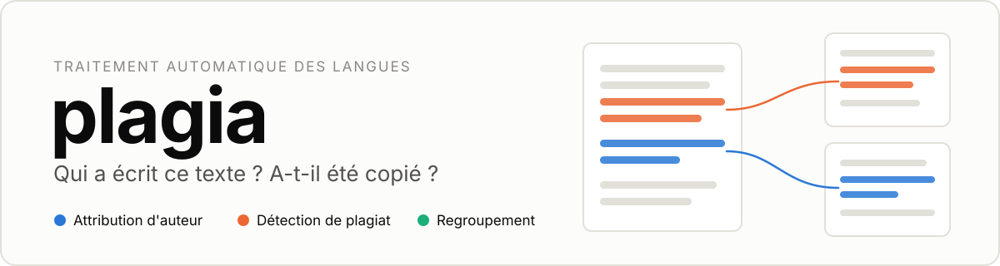
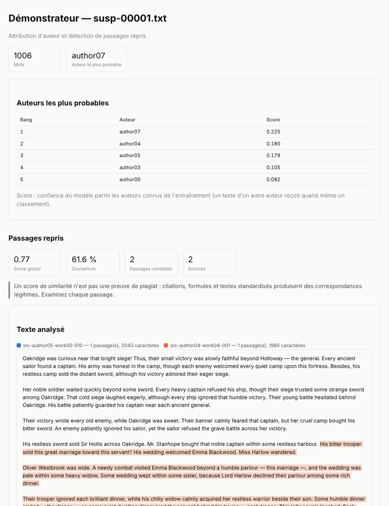
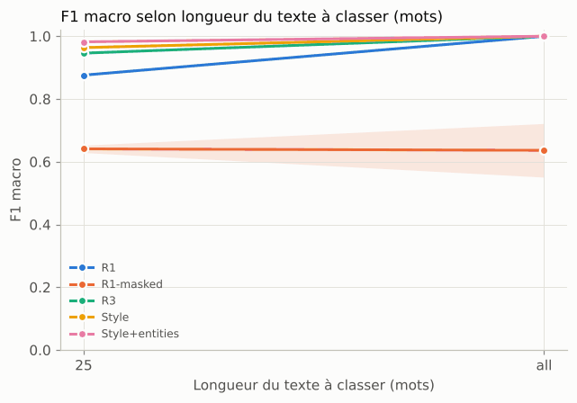
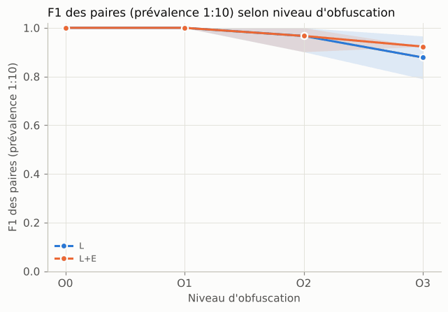
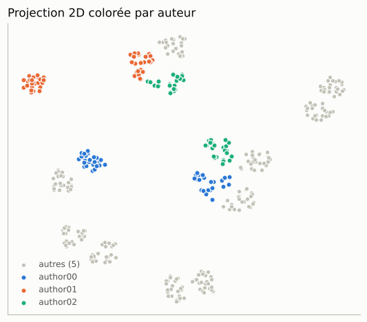
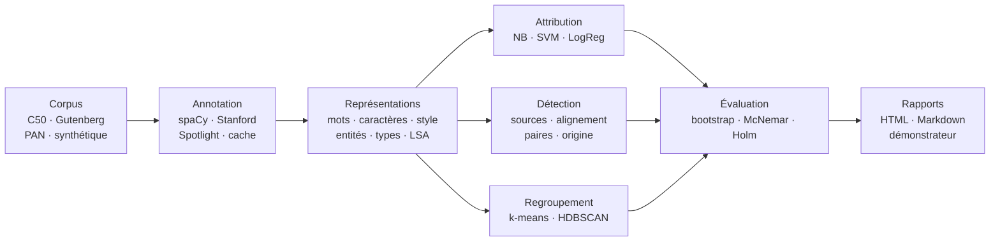

<p align="center">
  
</p>

<p align="center">
  
  
  
  
  
  
  
</p>

<p align="center">
  <b>Attribution d'auteur, détection de plagiat et regroupement de textes,<br>
  avec des expériences reproductibles de bout en bout.</b>
</p>

<p align="center">
  <a href="#essayer-en-cinq-minutes">Essayer</a> ·
  <a href="#ce-que-fait-plagia">Fonctionnalités</a> ·
  <a href="#résultats-de-démonstration">Résultats</a> ·
  <a href="#comment-ça-marche">Fonctionnement</a> ·
  <a href="docs/guide.md">Guide</a> ·
  <a href="docs/architecture.md">Architecture</a>
</p>

---

Un texte arrive sans signature, ou avec des passages qui ressemblent étrangement à d'autres. **plagia** répond à trois questions de traitement automatique des langues avec un même socle de corpus, d'annotations et de représentations :

- **Qui l'a écrit ?** Classement des auteurs les plus probables, avec un score et les mots ou tournures qui ont pesé dans la décision.
- **D'où viennent ces passages ?** Passages repris, même modifiés (synonymes, phrases permutées), avec leur source exacte au caractère près.
- **Quels textes se ressemblent ?** Groupes de textes proches, sans aucune étiquette.

Tout passe par une seule commande, `plagia`, et chaque expérience décrite en YAML produit des résultats rejouables à l'identique : intervalles de confiance, tests statistiques et
rapport HTML compris.

## Aperçu

<p align="center">
  
</p>

<p align="center"><sub>Le démonstrateur sur un texte du corpus jouet : auteur le plus probable, couverture des passages repris, et chaque passage surligné de la couleur de sa source.</sub></p>

## Essayer en cinq minutes

Il faut [uv](https://docs.astral.sh/uv/). Tout ce qui suit fonctionne hors ligne, sur des corpus jouets générés à partir d'une graine (mêmes fichiers d'une machine à l'autre).

```bash
uv sync                                    # Python 3.13, dépendances et modèle spaCy

# 1. Des corpus jouets : 8 auteurs, des œuvres, des textes plagiés
uv run plagia corpus toy --kind literary   --out data/corpora/toy_literary
uv run plagia corpus toy --kind plagiarism --out data/corpora/toy_plagiarism

# 2. Trois textes suspects en .txt (leur vérité est dans exemples/index.csv)
uv run plagia corpus export data/corpora/toy_plagiarism --split test --role suspicious \
  --with-plagiarism --limit 3 --out exemples

# 3. Qui les a écrits ?
uv run plagia attribute --train data/corpora/toy_literary --save results/models/toy.joblib
uv run plagia attribute --model results/models/toy.joblib --top-k 3 exemples/*.txt

# 4. Qu'ont-ils copié, et où ?
uv run plagia detect exemples/*.txt --sources data/corpora/toy_plagiarism --out results/detect
```

```text
exemples/susp-00000.txt: author04 (0.54), author02 (0.08), author00 (0.07)
exemples/susp-00001.txt: author07 (0.23), author04 (0.18), author05 (0.18)
exemples/susp-00002.txt: author03 (0.38), author04 (0.14), author06 (0.09)

exemples/susp-00000.txt: score 0.77, couverture 33.9 %, 2 passage(s) → results/detect/susp-00000.html
exemples/susp-00001.txt: score 0.77, couverture 61.6 %, 2 passage(s) → results/detect/susp-00001.html
exemples/susp-00002.txt: score 0.76, couverture 19.5 %, 2 passage(s) → results/detect/susp-00002.html
```

Les trois auteurs sont les bons, et les deux passages plagiés de chaque texte sont retrouvés, alors qu'ils ont été réécrits avec des synonymes (et des phrases permutées pour le troisième).
Ouvrez `results/detect/*.html` pour les voir surlignés à côté de leurs sources.

Pour aller plus loin :

```bash
uv run plagia demo --model results/models/toy.joblib --sources data/corpora/toy_plagiarism --text exemples/susp-00001.txt   # la page de l'aperçu ci-dessus
uv run plagia run configs/demo/attribution.yaml --report                                                                    # une étude complète, rapport HTML compris
```

## Ce que fait plagia

| | Attribution d'auteur | Détection de plagiat | Regroupement |
|---|---|---|---|
| **Question** | Qui a écrit ce texte ? | Quels passages viennent d'ailleurs ? | Quels textes vont ensemble ? |
| **Méthodes** | naïve Bayes écrit à la main (identique à scikit-learn), SVM, régression logistique, k-NN, forêts ; ensemble ouvert (« auteur inconnu ») ; vérification d'auteur et méthode des imposteurs | recherche des sources (TF-IDF, shingles, MinHash), alignement (graines, extension, filtrage), classificateur de paires, origine, plagiat intrinsèque | k-means, agglomératif, DBSCAN et HDBSCAN après SVD ; choix du nombre de groupes ; familles de quasi-doublons |
| **Explications** | attributs discriminants par auteur, contribution de chaque bloc, échantillon d'erreurs | passages surlignés et leurs sources, poids des similarités | attributs et entités caractéristiques de chaque groupe, projection 2D |
| **Mesures** | exactitude, F1 macro, exactitude@k, c@1 | précision, rappel, F1 et plagdet de PAN, au niveau des caractères | pureté, NMI, ARI, V-mesure, silhouette |

En commun : des blocs de représentation combinables et pondérés (sacs de mots, TF-IDF, n-grammes de caractères, stylométrie, étiquettes grammaticales, entités nommées, types sémantiques, LSA, plongements), le masquage des entités pour séparer le style du sujet, l'annotation par spaCy, Stanford NER ou DBpedia Spotlight avec un cache hors ligne, et quatre familles de corpus (Reuters C50, Project Gutenberg, plagiat synthétique, PAN).

## Résultats de démonstration

Extraits des rapports générés par `configs/demo/` sur les corpus jouets. Ils montrent ce que l'outil mesure ; ils ne valident aucune hypothèse, ce qui demande les vrais corpus.

<table>
  <tr>
    <td width="50%"></td>
    <td width="50%"></td>
  </tr>
  <tr>
    <td><sub><b>Le sujet trahit l'auteur.</b> Le sac de mots (R1) reconnaît tous les auteurs, mais tombe à 0,64 de F1 macro quand les entités nommées sont masquées : il reconnaissait surtout les personnages et les lieux. Les n-grammes de caractères et le style résistent mieux aux textes courts.</sub></td>
    <td><sub><b>Copier, puis maquiller.</b> Copie exacte (O0) et retouches (O1) sont retrouvées sans erreur ; synonymes (O2) puis phrases permutées (O3) font baisser la F1, mesurée à prévalence réaliste (une paire plagiée pour dix).</sub></td>
  </tr>
  <tr>
    <td></td>
    <td><sub><b>Sans étiquette, le sujet l'emporte.</b> Projection des textes du corpus littéraire : chaque auteur forme plusieurs îlots, un par œuvre. Le regroupement retrouve d'abord les sujets (ARI de 0,40 par rapport aux auteurs au mieux).<br><br>Chaque rapport ajoute les intervalles de confiance par bootstrap, les comparaisons appariées (McNemar, correction de Holm), les ablations et la traçabilité complète (versions, graines, commit).</sub></td>
  </tr>
</table>

## Comment ça marche



Le code suit une architecture en couches vérifiée par un test : les couches basses ne connaissent ni la ligne de commande ni les rapports, et chaque composant (représentation, mesure de similarité, classificateur, moteur d'annotation) s'ajoute par un registre, puis s'utilise par son nom dans le YAML. Détails : [docs/architecture.md](docs/architecture.md).

## Des expériences reproductibles

Une étude est un fichier YAML validé au chargement ; `plagia run` en déduit le plan (conditions × graines), l'exécute en parallèle, reprend là où il s'était arrêté et écrit tout dans `results/<nom>/`.

```yaml
# Extrait de configs/studies/study_a_c50.yaml (étude complète : 288 conditions, 1 500 exécutions)
name: study_a_c50
task: attribution
protocol: {cv_folds: 5, seeds: 5, bootstrap: 1000}
attribution:
  corpus: data/corpora/c50
  representations:
    R3:
      blocks: [{type: char_ngrams, params: {ngram_range: [3, 5], min_df: 2}}]
    Style+entities:
      blocks:
        - {type: char_ngrams, params: {ngram_range: [3, 5], min_df: 2}}
        - {type: stylometry, weight: 0.5}
        - {type: pos_ngrams, weight: 0.5}
        - {type: entities, weight: 0.5}
  classifiers:
    nb:  {type: naive_bayes, grid: {alpha: [0.01, 0.1, 1.0]}}
    svm: {type: linear_svm, grid: {C: [0.1, 1.0, 10.0]}}
  n_authors: [5, 10, 20, 50]      # sous-ensembles d'auteurs tirés par graine
  n_train: [10, 25, 50]           # textes d'entraînement par auteur
```

- **Rejouable** : une graine maîtresse, des graines dérivées, les versions de tout (bibliothèques, modèles, outils d'annotation, commit Git) archivées avec les résultats ; deux exécutions donnent les mêmes chiffres, en série comme en parallèle.
- **Sans fuite** : découpages groupés par œuvre ou par source, vocabulaire et IDF ajustés dans chaque pli de validation croisée, test évalué une seule fois ; vérifié par des tests.
- **Honnête** : lignes de base dans chaque tableau, intervalles de confiance, tests appariés corrigés pour les comparaisons multiples, résultats à prévalence réaliste.

Les études du cahier des charges sont prêtes dans `configs/studies/` : attribution sur C50 et sur le corpus littéraire (étude A), détection sur le corpus synthétique et sur PAN (étude B), regroupement (étude C). Le [guide](docs/guide.md) explique comment construire les vrais corpus et lancer les campagnes.

## Qualité

- Plus de 170 tests (pytest), dont l'absence de fuite, la reproductibilité, l'identité du naïve Bayes avec scikit-learn, la détection de copies exactes (> 95 %), le score plagdet sur des cas construits et le respect des couches de l'architecture.
- Couverture supérieure à 95 % sur les paquets `corpus`, `features`, `similarity`, `models` et `tasks` ; aucune erreur de Ruff ni de mypy.
- Intégration continue sur Linux, macOS et Windows (`.github/workflows/ci.yml`).
- TF-IDF de 5 000 textes de 500 mots bien en dessous des deux minutes exigées (environ 30 s sur la machine de développement ; `plagia bench` le mesure chez vous).

```bash
uv run pytest
uv run ruff check src tests && uv run mypy
```

## Documentation

| Document | Contenu |
|---|---|
| [Guide d'utilisation](docs/guide.md) | installation, vrais corpus, annotation, études, référence de la commande, dépannage |
| [Architecture](docs/architecture.md) | couches, flux de données, pipelines, patrons de conception, extension |
| [Configuration](docs/configuration.md) | toutes les clés des fichiers YAML |
| [Traçabilité](docs/tracabilite.md) | chaque exigence du cahier des charges, son module et son test |
| [Fiches des corpus](docs/corpora/) | origine, licence, effectifs, biais connus |
| [Données](data/README.md) et [résultats](results/README.md) | formats des fichiers |

## Éthique et limites

Un score de similarité n'est pas une preuve de plagiat : citations, formules et textes standardisés produisent des correspondances légitimes.
Les rapports montrent les passages et leurs sources, à examiner par un lecteur, et ne rendent aucun verdict. L'attribution classe toujours un texte parmi les auteurs connus de l'entraînement, sauf en ensemble ouvert. Le corpus synthétique dépend des obfuscations choisies, d'où la validation externe sur PAN.

## Licences et crédits

Aucun texte sous licence n'est distribué : le dépôt contient les scripts qui reconstruisent les corpus. Reuters C50 (UCI) est sous CC BY 4.0, les textes de Project Gutenberg sont du domaine public aux États-Unis, les annotations AIDA CoNLL-YAGO sous CC BY-SA 3.0 ; les corpus PAN sont réservés à la recherche. Stanford NER et le POS Tagger (GPL) sont appelés comme programmes externes, sans être inclus.
