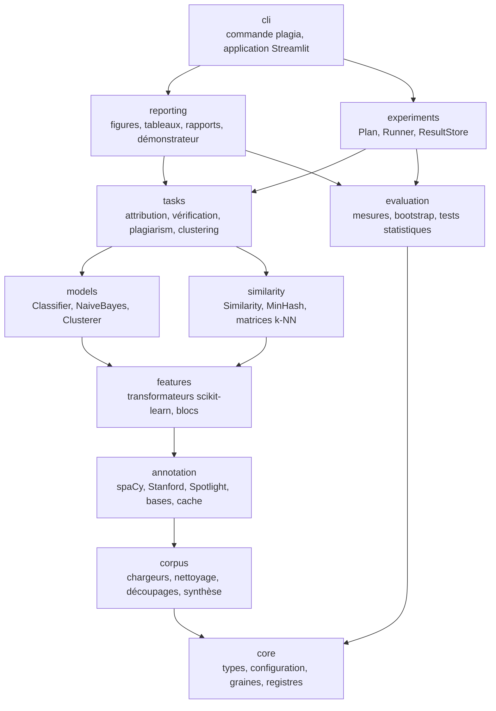
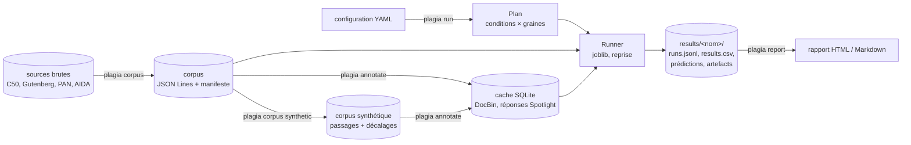
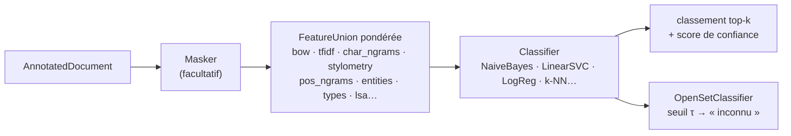
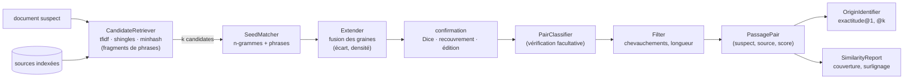

# Architecture

Le paquet `plagia` suit une architecture en couches (§ 6.1 du cahier des charges) : chaque couche ne dépend que de celles du dessous. Les couches basses ne connaissent ni la ligne de commande ni les rapports ; elles s'exécutent sans interface et se testent isolément. La règle est vérifiée automatiquement par `tests/test_architecture.py`, qui analyse les imports de chaque module.

## Couches



Une flèche signifie « peut importer » ; la relation est transitive (une couche peut importer toutes celles qui sont sous elle). `evaluation` ne dépend que de `core` : les mesures restent indépendantes des modèles qu'elles évaluent.

| Couche | Rôle | Éléments principaux |
|---|---|---|
| `core` | types et services communs | `Document`, `Passage`, `PassagePair`, `Corpus` ; configuration pydantic immuable (`ExperimentConfig`, `load_config`) ; graines dérivées (`derive_seed`, `make_rng`) ; `Registry[T]` ; cache disque ; E/S atomiques ; versions de l'environnement |
| `corpus` | données | chargeurs C50, Gutenberg, PAN, AIDA ; nettoyage ; détection de la langue ; découpages groupés et contrôle des fuites ; manifestes ; stockage JSON Lines ; obfuscateurs et générateur de plagiat synthétique ; corpus jouets |
| `annotation` | enrichissement | `Preprocessor` ; `EntityRecognizer` et `Annotator` (spaCy, Stanford, heuristique) ; schéma d'étiquettes commun ; `SpotlightLinker` ; `TypeHierarchy`, `DbpediaKnowledgeBase`, `YagoKnowledgeBase` ; `AnnotationCache` et proxy `CachedAnnotator` ; qualité sur AIDA |
| `features` | représentations | `BagOfWords`, `Tfidf`, `CharNgrams`, `Stylometry`, `PosNgrams`, `EntityFeatures`, `TypeFeatures`, `Lsa`, `Doc2VecEmbedding`, `WordVectors`, `SentenceEmbeddings`, `Masker` ; `build_representation` (union pondérée de blocs) et ablations |
| `similarity` | mesures | `Similarity` et registre ; Jaccard, Dice, recouvrement, cosinus, LCS, Levenshtein, similarité d'entités, divergence de types, sémantique, Word Mover ; `MinHasher`, `MinHashIndex`, winnowing ; matrices creuses des k plus proches voisins ; choix du seuil |
| `models` | apprentissage | `Classifier` (`fit`, `predict`, `predict_scores`, `rank`, `explain`) ; `NaiveBayes` (multinomial et Bernoulli, NumPy) ; `SklearnClassifier` ; `OpenSetClassifier` ; `Clusterer` (k-means, agglomératif, DBSCAN, HDBSCAN) |
| `tasks` | tâches | `AuthorshipAttributor` ; `AuthorVerifier`, `ImpostersVerifier` ; `plagiarism` (`CandidateRetriever`, `SeedMatcher`, `Extender`, `Filter`, `TextAligner`, `PairClassifier`, `OriginIdentifier`, `IntrinsicDetector`, `ExtrinsicDetector`, `build_report`) ; regroupement (`choose_k`, familles de quasi-doublons, interprétation, projection 2D) |
| `evaluation` | mesures | classification, détection, c@1, PAN (plagdet), regroupement ; bootstrap ; McNemar, Holm, Wilcoxon, κ de Cohen ; comparaisons appariées ; attributs discriminants et échantillons d'erreurs |
| `experiments` | campagnes | `Plan` (conditions × graines, lignes de base), `Runner` (parallèle, reprise), `ResultStore`, exécutions par tâche, synthèses et comparaisons |
| `reporting` | restitution | figures matplotlib (palette validée), tableaux, rapports HTML et Markdown, rapport de similarité, démonstrateur |
| `cli` | interface | `plagia` et ses sous-commandes ; application Streamlit |

## Flux de données



1. `corpus` charge les sources brutes, nettoie, découpe sans fuite et écrit les corpus avec leur manifeste ; la génération synthétique produit les plagiats et leurs décalages.
2. `annotate` calcule étiquettes, entités, liens et types, et remplit le cache. Dans une expérience, les annotations sont préparées une fois par processus, hors de la boucle d'apprentissage (`ExperimentContext`), puis lues dans le cache.
3. La configuration YAML décrit l'expérience ; `Plan` en déduit les conditions (produit des facteurs, filtres `include` / `exclude`, lignes de base) et les graines.
4. `Runner` exécute les conditions en parallèle : ajustement sur l'entraînement (validation croisée), prédiction sur le test, métriques et intervalles de confiance, écriture incrémentale dans `runs.jsonl`. Une exécution en erreur est consignée sans arrêter la campagne.
5. `finalize` produit `results.csv`, `summary.csv` et `comparisons.csv` ; `reporting` lit ces fichiers et les artefacts pour produire le rapport.

## Attribution d'auteur



Chaque condition construit un `Pipeline` scikit-learn (blocs puis classificateur). Le réglage utilise `GridSearchCV` avec `StratifiedKFold` (ou `StratifiedGroupKFold` par œuvre) : le vocabulaire, l'IDF, les échelles et la réduction de dimension sont ajustés **dans chaque pli**, puis sur tout l'entraînement pour le modèle final ; le test n'est vu qu'une fois.

## Détection de plagiat



Le classificateur de paires (`PairClassifier`) note des fenêtres de phrases à partir d'un vecteur de similarités (cosinus TF-IDF, recouvrement et Jaccard de shingles, Dice, LCS, Levenshtein, rapport de longueurs ; Jaccard et cosinus d'entités, divergences de types ; similarité sémantique).
Il est entraîné sur des paires positives et des négatives difficiles (même sujet ou mêmes entités, sans reprise) et son seuil est choisi sur la validation. Il sert de vérificateur dans l'alignement (`mode: seeds`), de détecteur sur fenêtres (`mode: windows`) ou les deux (`mode: both`). `IntrinsicDetector` repère les fenêtres stylistiquement atypiques sans source. Les décalages de caractères sont conservés de bout en bout, ce qui permet les mesures de PAN au niveau des caractères.

## Patrons de conception

| Patron | Où |
|---|---|
| Stratégie | `Classifier`, `Similarity`, `Annotator`/`EntityRecognizer`, `Clusterer`, obfuscateurs : interchangeables derrière une interface commune |
| Adaptateur | `StanfordNer`, `StanfordPosTagger` (processus Java), `SpotlightLinker` (REST), `YagoKnowledgeBase` (SPARQL), `SklearnClassifier` (modèles scikit-learn) |
| Proxy | `CachedAnnotator` : consulte le cache SQLite avant l'outil ; en mode hors ligne, une absence du cache est une erreur |
| Registre | `Registry[T]` : `FEATURE_BLOCKS`, `SIMILARITIES`, `CLASSIFIERS`, `CLUSTERERS`, `ANNOTATORS`, `OBFUSCATORS` ; instanciation par nom depuis le YAML (et table `RUNNERS` : tâche → exécution) |
| Pipeline | `Pipeline` et `FeatureUnion` de scikit-learn ; chaîne d'obfuscateurs (`Chain`) |
| Injection de dépendances | téléchargements (`fetcher`), requêtes HTTP (`http_post`), traducteurs et paraphraseurs fournis en paramètre : tests hors réseau |

Les dépendances facultatives (Gensim, sentence-transformers, UMAP, networkx, Stanford, Spotlight, Streamlit) sont importées à la demande ; leur absence lève `MissingDependencyError` avec la commande d'installation, sans empêcher le socle.

## Étendre le projet

Un nouveau composant s'ajoute par un registre, sans modifier le reste ; il devient utilisable depuis le YAML par son nom.

```python
from sklearn.base import BaseEstimator, TransformerMixin
from sklearn.linear_model import RidgeClassifier

from plagia.features.base import register_block
from plagia.similarity.base import SIMILARITIES, Similarity, text_of
from plagia.models.base import CLASSIFIERS
from plagia.models.sklearn_models import SklearnClassifier


@register_block("sentence_lengths", family="stylometry")   # bloc de caractéristiques
class SentenceLengths(TransformerMixin, BaseEstimator):
    def fit(self, documents, y=None): ...
    def transform(self, documents): ...                    # matrice (creuse ou dense), une ligne par document


@SIMILARITIES.register("prefix")                           # mesure de similarité
class Prefix(Similarity):
    name = "prefix"
    symmetric = True

    def score(self, a, b) -> float:
        x, y = text_of(a), text_of(b)
        ...


CLASSIFIERS.add("ridge", lambda **p: SklearnClassifier(RidgeClassifier(**p)))   # classificateur
```

Un moteur d'entités hérite d'`Annotator` (méthodes `process`, `convert`, `version`, `serialize`/`deserialize` pour le cache) et s'enregistre dans `ANNOTATORS` ; il bénéficie alors du cache, du schéma commun et du liage sans autre changement.

## Garde-fous contre les fuites

- Découpages groupés (œuvre, source, composante connexe de paires) ; `check_no_leakage` vérifie l'absence d'identifiants, de groupes, de textes et de sources communs entre jeux.
- Déduplication exacte qui conserve la copie d'entraînement.
- Nettoyage des signatures, en-têtes et mentions de l'auteur qui révéleraient l'étiquette.
- Tout ajustement (vocabulaire, IDF, échelles, SVD, seuils, τ) est fait sur l'entraînement ou la validation, jamais sur le test ; vérifié par des tests dédiés.
